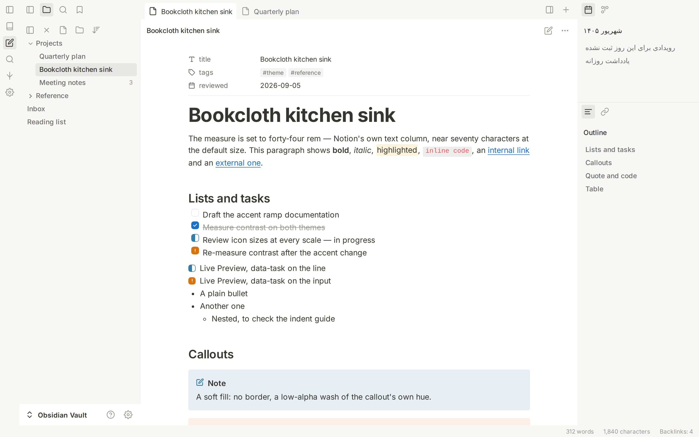
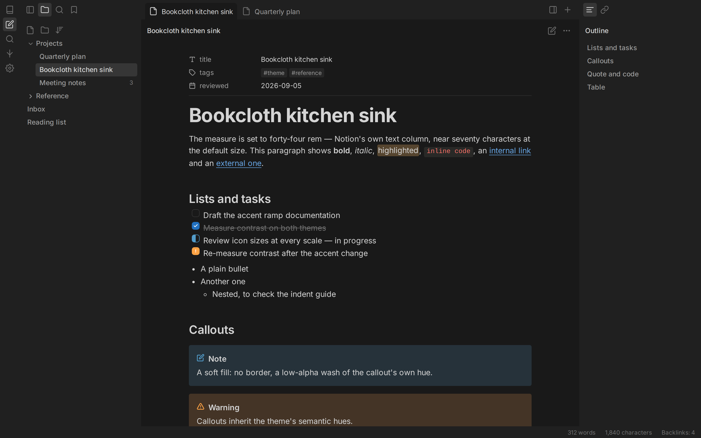

# Bookcloth

Notion, in Obsidian. A white page against warm-grey chrome, a 14px interface
over a 16px document, 4px corners, 16px icons, and flush panels that meet
without a gap or a line. Minimal in what it draws, not in what it covers.





## Install

1. Copy the `Bookcloth` folder into `YourVault/.obsidian/themes/`.
2. Obsidian → Settings → Appearance → Themes → **Bookcloth**.

Only `theme.css` and `manifest.json` are needed at runtime. Everything else is
source, documentation or development tooling.

**Recommended companion:** the community plugin **Style Settings**. Bookcloth
is complete without it; with it you get around sixty controls covering colour,
type, shape, density, icons, panel layout and plugin support.

## What "like Notion" means here

Not a mood board. Where Notion states a figure, that figure is used:

| | Notion | Bookcloth |
| --- | --- | --- |
| Page / chrome, light | `#ffffff` / `#f7f7f5` | same |
| Page / chrome, dark | `#191919` / `#202020` | same |
| Body ink | `#37352f` | same |
| Interface text | 14px | 14px |
| Document text | 16px / 1.5 | same |
| Page title | 40px / 700 | same |
| Headings | 30 / 24 / 20px at 600 | same |
| Text column | 708px | 44rem |
| Sidebar row | 27px tall, 4px corner | same |
| Buttons, inputs | 32px tall, 4px corner | same |
| Icon buttons | 28px square, 4px corner | same |
| Chrome icons | 16px | 16px |
| Menus / modals | 6px / 8px, three-layer shadow | same |
| Toggle | 26 × 16, 12px thumb | same |
| Hover / selected | `rgba(55,53,47,.06)` / `.08` | same |
| Elevation | `0 0 0 1px, 0 3px 6px, 0 9px 24px` | same |

The two deliberate departures are both about contrast, and both are listed
under [Accessibility](#accessibility).

## Flush panels

The sidebar, the tab strip and the page are three flush regions. Nothing is
boxed, nothing is separated by a drawn line — the tone change is the seam. The
ribbon is dissolved into the sidebar: same colour, no border, so it reads as
the top of the sidebar rather than as a fourth region.

The active editor tab is browser-shaped. It is the page colour, bottom-flush
against the editor, so the tab and the page below it are one surface — which is
what the Notion desktop app does with its own tabs. **Tab style** offers Pill (a
floating rounded tab) and Underline (a flat tab with a marker) instead.

**Floating panels** in Style Settings lifts every region onto its own rounded
card on a darker backdrop. Where that card is painted depends on how many panes
the sidebar holds, and getting it wrong costs one of two things. One pane and
the card is the split itself — which matters because a plugin can render a
footer bar as a direct child of the split, outside the pane entirely, and
painting the card further in leaves that bar with no surface under it and no
corner to be clipped by. Two or more and the card moves to each pane, so a
calendar above an outline reads as two panels rather than one tall surface;
flush, they are separated by a hairline instead. And the
panels stop above the status bar: Obsidian floats it over the bottom-right of
whatever is beneath it, which flush is fine and floating puts it on top of the
editor's own bottom corners. The gap only reads as a gap if the thing behind it
is darker, so the two are set together: **Gap between panels** and **Backdrop
behind the panels** are adjacent controls, and moving one usually means moving
the other. The gap is applied to the container, not as margins on the panels,
so the space between two panels is the same as the space at the window edge
instead of double it.

Every structural container behind a panel is transparent, and that is load-
bearing rather than tidy: Obsidian paints the root split `--background-primary`,
which is white, and a rounded corner on the panel inside it does not hide what
is behind it. A white wedge at the editor's corners was that element showing
through them — and no amount of clipping could have fixed it, because the white
was outside the panel rather than spilling out of it.

A rounded parent does not clip its children either, so a panel rounded at the
split still squares its own bottom corners the moment anything inside it paints — a
plugin footer, a vault-name bar, a view that fills its own background. The
corner is therefore handed down to whichever element owns it, and the panel is
clipped as well, with `overflow: clip` rather than `overflow: hidden`: clip does
not turn the panel into a scroll container, so it cannot swallow a pane's own
scrolling. Popovers are unaffected either way — menus, tooltips and suggestion
lists render into `document.body`, not into the pane. **Do not clip panel
corners** turns it off for anyone who finds a plugin that genuinely draws
outside its panel.

Every scrolling pane reserves room at its foot. The status bar floats over the
bottom of whatever is beneath it, and without that reserve the last item in a
sidebar list sits underneath it and is read as cut off — which it is. Only the
block end is padded; giving plugin panes horizontal padding is how a theme
breaks the ones that lay out their own.

## The accent

The default is Notion's blue, `#2383e2`. Change it in **Settings → Appearance →
Accent color** — that is the real control. Obsidian writes your choice to
`--accent-h/s/l` and Bookcloth builds a nine-step ramp plus seven alpha washes
from those three numbers. Links, the caret, checkboxes, selection, focus rings,
the focused graph node and every filled button move together.

Two things happen automatically:

- **Dark mode lifts the hue.** The same choice is rendered eight points lighter
  and slightly desaturated on dark ground, so one pick reads correctly in both
  modes without setting a second colour.
- **Filled controls do not follow that lift.** Buttons, toggles and checkboxes
  read from a separate step that ignores the lift and is clamped at 45%
  lightness, so white label text stays at 5:1 in both themes. Notion fills its
  primary button with the accent at full strength, which puts white text at
  3.9:1; this is one shade darker and nobody will notice the shade.

Chrome is neutral. In Notion the selected page in the sidebar is a plain grey
slab with ordinary dark text, and colouring it is what makes a sidebar start
looking like a dashboard — so the accent is kept for links, the caret,
checkboxes and focus, where it carries meaning. **Accent intensity → Vivid**
washes the accent back through the chrome, tabs and tags; **Subtle** drops the
selected row to a whisper.

## Typography

Notion's scale, all of it relative to `--font-text-size` so Obsidian's own
font-size slider keeps working:

- **Interface** at 14px, with a 12px step for hints, hotkeys and counts. This
  matters more than it sounds — Obsidian's default 13px reads cramped beside
  Notion, and Obsidian gives menu items, buttons and settings the same variable,
  so all three had to move together.
- **Page** at 16px on 1.5 leading, in a 44rem column.
- **Title** at 40px / 700; **headings** at 30 / 24 / 20px, all at 600. Space
  above a heading belongs to the heading and space below belongs to the content
  it introduces, in roughly Notion's 8:1 proportion — which is what makes a long
  page read as sections rather than as one column.
- **Links** are the accent, underlined where they sit. **Link style** offers
  Plain (underline on hover only) and Ink — Notion's own inline-link treatment,
  body colour with a faint rule.
- **Inline code** is Notion's red on a grey chip. **Inline code in body ink**
  turns it off.
- **Quotes** take Notion's 3px rule and full-contrast text, not a grey italic.
- **Tables** are Notion's grid: a hairline on every cell, header row on the
  chrome tone.

## Settings

| Group | What's in it |
| --- | --- |
| Accent | Accent override, intensity, neutral warmth, accent headings |
| Surfaces | Page / sidebar / raised / sunken backgrounds, border strength |
| Text colours | Body, muted and faint ink, separately per theme |
| Semantic colours | All eight hues — red through pink — separately per theme |
| Typography | Interface / editor / mono font, serif body, heading scale and weight, line height, code size, link style, inline code colour, Persian and Arabic support |
| Shape and density | Corner radius, icon button size, space between icon buttons, sidebar row height, density, note width, visible borders |
| Floating panels | Float the panels, gap, backdrop colour, corner clipping |
| Icons | Icon size, stroke weight |
| Interface | Tab style, indentation guides, hide status bar, hide ribbon |
| Editor | Callout style and colour strength, checkbox size and style, in-progress and needs-attention colours, task fading, active line |
| Plugin support | Opt out of any of the bundled plugin styles |

Every plugin style is **on by default** and the toggles turn them off, so
nothing depends on having Style Settings installed. Turning every control off
still leaves a complete theme.

Semantic colours are authored as RGB triples, so one picker drives both the
solid colour and every wash derived from it — change Blue and the note callout,
the blue tag, the syntax token and the graph node all follow.

## The window frame

On Windows and Linux, Obsidian draws the minimise, maximise and close buttons
itself and leaves them at the platform's colours — a grey block in the corner
of an otherwise quiet interface. They are restyled like anything else: flat,
the same muted glyph as every other icon, a grey hover, and the one red that
platform convention reserves for close.

## The top band

Obsidian spreads the controls along the top of the window across four separate
containers: the ribbon column, the left sidebar's tab strip, the editor tab bar
and the right sidebar's tab strip. Each brings its own padding, so left alone
the sidebar-toggle button sits a few pixels above the tabs beside it and what
should be one row reads as three.

Bookcloth gives all four the same 45px band and the same 28px control, so every
icon in that row shares one centre line — and the same 6px between them, which
is its own setting because how far apart 28px squares sit is the one number
that decides whether a toolbar reads as a row of buttons or as one bar with
seams in it.

The band is one number and the inset is worked out from it: a 28px control
centres in a 45px band at 8.5px, so `--bc-band-pad` is
`(band − control) / 2` rather than a figure of its own. It had been a figure of
its own, and a live dump showed what that costs. Obsidian sizes the tab strips
from `--header-height`, which the theme was setting to 45px while positioning
the ribbon's collapse control against a separate `--bc-topbar-height` of 40px.
Two numbers for one band, 2.5px apart, in the one row where nothing is allowed
to be 2.5px out. `--header-height` is now set from the band rather than given
an opinion of its own, and `node invariants.mjs` fails if the two ever drift.

The sidebar collapse control took eight releases, and the reason is worth
writing down because none of the seven wrong answers looked wrong at the time.

Obsidian ships it as `position: absolute; top: 0` **inside a ribbon it ships
static** — and a static element is not a containing block. That `top: 0` never
resolved against the ribbon at all. It resolved against an ancestor further up,
dropped the control above the ribbon entirely, and the 45px top margin Obsidian
puts on the ribbon exists to hold open the space it landed in. Forty-five pixels
of margin reserving room for a 28px control sitting outside the element it
belongs to.

Making the ribbon `position: relative` gives the control the containing block it
was always written for. The margin then has nothing to hold, so it becomes
padding: the same clearance, moved to where the control actually is. Three
declarations, and the empty band at the top of the ribbon closes.

Everything before that was guesswork, and it cost real regressions — a 40px hole
where the glyph should have been, every ribbon action pushed down a second time,
a control that vanished entirely. Two things made the guessing expensive:

- **A selector that is merely wrong looks exactly like one being outranked.**
  Both produce "nothing happened". `.workspace-ribbon-collapse-btn` is the name
  Minimal and Things use, and current Obsidian calls it `.sidebar-toggle-button`;
  aiming at one while running the other is indistinguishable from losing a
  specificity contest. Both names are carried now.
- **The harness drew the tidy version of the element** — in the flow, inside its
  parent, visible — and none of the three things that were actually true of it.
  `app-shim.css` now transcribes the live measurements instead.

Two of its numbers are `!important`: the `top` that puts it on the band, and the
margin that has to come off the ribbon. Both are measured values rather than
preferences, and both sit behind Obsidian selectors that carry an extra class or
element depending on platform and frame mode. `node measure.mjs` checks it first:
it and the three controls beside it all have to return a centre-y of 20.

## One radius, and everything is a ratio of it

Notion's whole interface sits between 3px and 8px, and the relationships
between those figures matter more than the figures themselves — a 27px sidebar
row and a 640px modal should not round to the same number.

So there is one control, **Corner radius**, and every corner in the theme is a
multiple of it:

| | Ratio | At the default 4px |
| --- | --- | --- |
| Tags, the smallest chips | 0.75× | 3px |
| Rows, buttons, inputs, code, callouts | 1× | 4px |
| Menus, tabs, popovers | 1.5× | 6px |
| Modals, floating panels | 2× | 8px |
| Checkboxes | 1.25× | 5px |

Move it to 0 and the interface is square; move it to 12 and it reads like a
modern macOS app — the proportions hold either way, because nothing in the
theme carries a radius of its own.

Every icon-only control is a square of a single size, set by **Icon button
size**. This matters more than it sounds: Obsidian's sidebar tabs are wider
than they are tall, so a rounded background on the tab slot itself reads as an
oval. Bookcloth moves the background onto a square inner element and centres
the icon in it, and applies the same square to ribbon actions, view actions and
plugin toolbar buttons — including Obsidian's sidebar-toggle button, which
lives in a different container from the actions below it and otherwise sits off
the column they share.

## Icons

Notion's icon set is solid and sits at 16px. Obsidian ships Lucide, which is
outline artwork drawn on a 24-unit grid with a 2px stroke — and a 2px stroke
rendered at 14px is 1.17px on screen while the same stroke at 28px is 2.33px.
Scaling the artwork without adjusting the stroke is what makes sidebar chevrons
look spindly next to ribbon glyphs.

So Bookcloth pairs a stroke weight with every size. Two sliders scale the whole
thing: **Icon size** and **Icon stroke weight**. Pointer target minimums are
enforced on touch only — forcing a minimum square on desktop is what widens
every button in a dense plugin toolbar.

The pairing has one rule that took a live measurement to learn: **the same
rendered size must mean the same stroke**, whichever token an element happens to
resolve. Obsidian ships `--icon-l` at 18px, identical to `--icon-m`, and its own
stylesheet hands the ribbon and the sidebar tab icons the *l* role while pane
actions get *m*. That is invisible while the two agree. Bookcloth had made *l* a
step larger with a stroke of its own, and a dump from a real vault came back
with three weights — 1.575px, 1.71px and 2px — on 18px icons standing in one
row, because Obsidian assigns those roles at a specificity a two-class selector
cannot answer. The fix is not to win that argument on every selector; it is to
make *l* and *m* the same size and the same stroke, so there is nothing to
argue about. Where the theme forces an icon's box it forces the stroke in the
same declaration, for the same reason — a forced size with an inherited weight
is how the row broke in the first place.

Three sizes, three roles, and every icon in a given row shares one of them —
which is the point. 14px for inline markers (chevrons, property keys, the tab's
close button), 16px for icons that label a line of text (menu rows, callout
titles), 18px for every icon that is a button in the chrome. A 16px control
beside an 18px control reads as a mistake even when neither is wrong alone.

The folding chevrons are the one place Obsidian sets `stroke-width` on the
element itself, so they never see `--icon-stroke` and were still drawing at the
4px it chose for the 10px box it ships — a weight that becomes a blob at 14px.
Carrying that ratio across to 14px was tried and dropped: it left two stroke
weights at one size, which is the defect this whole pass exists to remove.

`--icon-size` only reaches artwork that carries Obsidian's `.svg-icon` class
and reads the variable. Plugins ship their own and size it themselves, which is
how a pane header ends up with four icons at the theme's size and three at
whatever the plugin picked. Inside a chrome icon button the size is the
button's to decide, so it is set on the element rather than left to a variable
nobody else reads.

## Tasks

`- [x]` is a filled box with a white tick. `- [/]` is outlined in its own
colour and filled to the halfway line — no glyph, because a mark inside a
half-filled box is two signals competing for eighteen pixels and the amount of
colour is the one that reads without being looked at. `- [!]` is filled with
the one glyph that means it.

`- [/]` follows the accent, and is the same fill as a done box. The two are one
piece of work at two stages, and a box filled halfway with the accent says how
far along without needing a second hue to say it. It takes the accent's
*clamped* step rather than the raw accent, because a pale accent — a light teal,
say — puts a 1.9:1 edge on white, and a checkbox border is a boundary that has
to be visible.

`- [!]` keeps a hue of its own. It is not a stage of the same work, it is an
interruption, and colouring it with the accent is precisely how it stops being
one. Both remain colour controls in Style Settings; clearing an override hands
the in-progress box back to the accent.

The box is 1.15 of the text size rather than 1em: a checkbox sits beside body
text but is read as a control, and at exactly the text size it disappears into
the line. **Checkbox size** moves it.

Of the text size, and not `em`, for a reason worth writing down. A checkbox is
an `<input>`, and an input does not inherit `font-size` — `1em` on one is the
user agent's 13.33px, not the size of the words beside it. Written as `1.15em`
it measured **15.3px** in a real vault: smaller than Obsidian's own 18px
default, in the release that was supposed to make it bigger. Measured from
`--font-text-size` it is 1.15 of whatever the reader actually set — 20.7px at
an 18px base.

The tick is drawn from Lucide's check at a weight that survives at that size,
positioned to sit optically rather than mathematically centred. Its shape is
set on the element for both options rather than leaving the square as "the
state with no rule", so a box set to square cannot be quietly rounded again by
anything else that touches the radius.

## Transclusions

An embed is the one construct in Obsidian that nests a whole
`.markdown-preview-view` inside a block of the page. The inner view arrives
carrying everything the outer page gave it — the file margins, the centred
sizer, the readable-line max-width — inside a container a fraction of a page
wide. `--file-margins` ends in `20vh`, so before this was reset every embed
opened with a fifth of the window's height of blank space under its last line,
and anything sized for a full note ran past the edge and was quietly cut. A
page inside a page.

So the inner view is stripped back to being a block: no padding, no margin, no
max-width, no minimum height. Forced, because several plugins write to those
exact elements — pretty-properties pushes `.markdown-preview-sizer` down by a
banner height, which inside an embed is the same defect wearing a different
hat. This is structural rather than a preference. An embed is a block on *this*
page.

The container itself is a sunken card with one inset ring. A ring rather than
borders because Obsidian draws an embed's edge as four separate physical
borders, and four physical borders cannot be made symmetrical in a
right-to-left note without restating all of them. For the same reason the
open-in-full control is placed with a logical inset — pinned to the physical
right, it lands at the *start* of a Persian line, on top of the first heading —
and it is revealed on hover, the way Notion treats block controls, so it never
sits over the text at all. Hover-less pointers keep it visible.

Inside a callout the embed drops its fill — the callout supplies that — but
keeps a hairline in the callout's own colour and a small inset, so the tint
shows through and the block still reads as a block. Going fully flush was tried
and was a step too far: with no fill and no edge, a transclusion reads as text
the author typed.

And "the callout is already the container" is only true of a callout that draws
one. Under the **left-rule** callout variant it draws a 3px line and nothing
else, so an embed that drew nothing left the reader with no box anywhere on
screen. There the embed goes back to being the container and takes the full
sunken card. `invariants.mjs` now fails if an embed has no edge and sits in
nothing that has one.

The cut at the right edge had a second cause, and it needed a console dump of
the real note to find. The embed arrives with a **negative inline-start
margin** and stands 34px past its container. Obsidian gives `.callout`
`overflow: hidden` so its rounded corner stays clean — and in Live Preview the
callout is a `.cm-embed-block`, so that clip is not a theme's to switch off.
In a right-to-left note the side standing outside is the *right* one, which is
the side every line begins on. Thirty-four pixels of it, silently, off the
start of each line.

`.markdown-embed { margin-inline: 0 }` did not fix it: at one class it lost to
whatever sets that margin among the twenty-six stylesheets in the vault it was
measured in. Inside a callout the margin is now flagged. An embed standing
outside a container that clips is not a preference to be outvoted — it is text
the reader cannot see. Outside a callout the unflagged rule leaves a deliberate
bleed alone.

Embedding a *heading section* rather than a whole note still gets a title
element — with nothing in it. Height 0, and it kept the margin below it, so the
top of every such embed carried 4px the sides did not. In the vault this was
measured in, the content started at y 257.8 inside an embed that started at
253.8: exactly that margin, and nothing else. An element that draws nothing
takes no space, so an empty title is not rendered.

The padding was ragged in the one direction nobody declares. An embed's box is
read as a card, so the gap above the first line is compared against the gap
beside it — and measured across four embeds it came out anywhere between 12px
and 63px while every side stayed at 16px. Two causes: `--embed-padding` was
12px block against 16px inline, and the rule that clears the first block's top
margin was aimed at `:first-child`. Obsidian opens a preview with two
zero-height spacers, `.markdown-preview-pusher` and the view's own
`.mod-header`, so `:first-child` lands on a spacer and the first heading — one
place further down — keeps its margin. The padding is equal on all four sides
now, both spacers are named, and `invariants.mjs` measures the gap above the
first drawn thing against the gap beside it rather than trusting the
declaration.

Two smaller things came out of the same dump. The inner preview view keeps
`overflow: auto` from being a page, which in a right-to-left note reserves an
11px gutter down the left of every embed for a scrollbar with nothing to
scroll; it is `visible` here, since an embed has no height limit. And heading
fold arrows are absolutely positioned *outside* the text column, so inside an
embed they land beyond the container and get cut in half — they are dropped
inside embeds, because a view of a heading somewhere else does not need the
control that folds the real one.

One selector detail is worth recording, because it cost this release. The rule
had been written as `.internal-embed .markdown-embed` — and Obsidian puts both
of those classes **on the same element**, so it matched nothing at all. Every
embed in the theme was unstyled, and the symptom was indistinguishable from a
rule being outranked: the theme simply appeared not to have styled it. That is
the second time in this project that a selector matching nothing has been
mistaken for a specificity problem. `node invariants.mjs light embeds.html`
now measures the numbers that would have caught all of it — including the one
the first pass missed: an embed can fit its own content box perfectly and still
be cut, because it is the *container* that clips, so the check walks up to the
nearest ancestor that hides its overflow and measures against that — how much dead space
sits under an embed's last line, and how far anything in it runs past the
content box.

## Working with plugins

Plugins build their pane headers out of real `<button>` elements wrapping an
icon. A theme that gives every button a fill and a ring turns each of those
into a box, and in a narrow sidebar header the boxes take every spare pixel
from the label beside them — Notebook Navigator's folder name collapses to one
letter and an ellipsis. Bookcloth excludes icon-only buttons from the boxed
treatment at the source, in the `:not()` chain, rather than trying to un-style
them afterwards, because a later rule would lose the specificity contest.

The theme deliberately does not set padding on containers that plugins fill —
`.modal`, `.prompt`, `.menu`, `.suggestion-container`, `.setting-item`. It
restyles their colour, radius and shadow and leaves layout to Obsidian, because
a theme that repads those boxes double-pads some plugin dialogs and crops
others. The one exception is `.view-header`, which is *set* rather than added
to, so the inset is the same whatever Obsidian's own padding is underneath.

For the same reason there is no blanket `[data-type] .view-content` rule. Clipping the pane swallows anything a
plugin renders outside its own bounds, and forcing a background onto every
registered pane breaks canvases, boards and embedded editors that paint their
own surface.

Bundled styles: Dataview, Tasks, Kanban, Calendar and Periodic Notes,
Excalidraw, Iconize, Editing Toolbar, Omnisearch, Highlightr, Style Settings.
Anything not on the list inherits the correct surface, ink and radius from the
variable layer.

## Persian and Arabic

Turn on **Typography → Persian / Arabic typography**. It puts Vazirmatn and
Estedad at the front of the font stacks, raises the leading to 1.85, and removes
the negative letter-spacing that Latin display type wants and Arabic script
does not. It also re-derives the task-checkbox offset from the leading: that
offset centres the box on the first line, and a value measured against 1.5
leaves the box floating a third of a line above the words at 1.85.

Right-to-left support is not behind that toggle. Blockquotes, embeds, lists and
tables are written with logical properties, so they mirror on their own rather
than needing a second set of rules. Two cases genuinely need overriding and get
it: code runs left-to-right inside a right-to-left note — without that the bidi
algorithm reorders punctuation and a line of JavaScript comes out with its
semicolon at the wrong end — and inline Latin fragments are isolated so they
don't drag surrounding Persian out of order.

## Writing snippets against Bookcloth

The token layer is public:

```css
var(--bc-ac-50) … var(--bc-ac-800)          /* nine-step accent ramp */
var(--bc-ac-a03) … var(--bc-ac-a40)         /* transparent accent washes */
var(--bc-ac-fill) var(--bc-ac-fill-hover)   /* filled controls, contrast-safe */

var(--bc-surface-raised)                    /* modals, menus, cards */
var(--bc-surface-sunken)                    /* code blocks, wells */
var(--bc-control-border)                    /* the 1px inset ring on controls */
var(--bc-select-bg) var(--bc-select-bg-strong) var(--bc-select-fg)
var(--bc-gap-1) … var(--bc-gap-6)           /* density-aware spacing */
var(--bc-hit) var(--bc-row-height) var(--bc-row-inset)
var(--bc-topbar-height) var(--bc-control-height)
```

All of them respond to the user's accent, theme and density settings.

## Building

Written as partials and concatenated, because Obsidian loads one stylesheet per
theme.

```bash
node build.mjs
```

Edit files in `src/`, never `theme.css`. Order is defined in `build.mjs`:
tokens → light → dark → accent → type → chrome → editor → components → views →
icons → panes → mobile → RTL → plugins.

For live work, symlink the folder into a vault and use the Hot Reload plugin:

```bash
ln -s "$(pwd)" /path/to/vault/.obsidian/themes/Bookcloth
```

`preview/` holds a browser harness that reproduces Obsidian's DOM so you can
look at changes — and take screenshots and measure contrast — without launching
the app. See `preview/README.md`.

## Measuring the real app

A harness is only as good as its idea of the app, and the collapse control
proved that an idea can be wrong for eight releases while every screenshot looks
plausible. `tools/probe.js` removes the guessing: paste it into Obsidian's
devtools console (Ctrl+Shift+I) in a real vault and it dumps the actual
geometry — position, margin, padding, radius, gap, flex, overflow, computed
colour — of every region the theme touches.

```
bcProbe()                    every section
bcProbe('ribbon','editor')   only those
bcProbe('tree')              DOM skeleton with real class names
await bcBaseline()           the same run with the theme off, then restored
await bcSave()               write the result into the vault root as a file
```

Take the output through `bcSave`. DevTools truncates a long string in
`console.log`, and `copy()` is a command-line API that exists only at the top
level of what you type — calling it from inside a function silently does
nothing, which looks exactly like a successful copy.

Sections: `env`, `tokens`, `frame`, `ribbon`, `leftsplit`, `rightsplit`, `root`,
`editor`, `embeds`, `tasks`, `controls`, `overlays`, `icons`, `tree`.

`tools/embed-probe.js` is the narrow version of the same thing: paste it with
the misbehaving note open and it dumps the embed's whole ancestor chain outward
to the pane and its subtree inward, with each box's direction, overflow,
scroll extent and how far it runs past the content box. It also prints
`--bc-version`, because a screenshot cannot tell a fix that did not work from a
fix that was never installed, and this project has spent rounds on that
difference.

`embeds` reports the two numbers that say whether a transclusion is a block or a
page pretending to be one — the dead space under its last line and the widest
overflow past its content box — and whether Obsidian is putting
`internal-embed` and `markdown-embed` on one element or two, which decides
whether a descendant selector between them matches anything.

`bcBaseline` is the one that matters for the harness. `app-shim.css` is supposed
to reproduce *Obsidian*, not Bookcloth, so the numbers it should encode are the
ones the app computes with the theme switched off. It measures once with the
default theme, once with Bookcloth, restores the theme, and prints both — and
the difference between the two runs is exactly the theme's effect, with nothing
inferred.

`node invariants.mjs [light|dark] [page]` is the other half. The probe measures
the real app; this asserts, in the harness, the things the theme claims — one
band centre line across the four containers that hold it, one stroke per
rendered icon size, a header whose actions stay inside it and leave the title a
width, a checkbox no smaller than the one it replaces, and one number for the
band rather than two. Every check in it exists because the probe caught the
theme getting that exact thing wrong in a real vault, and because `measure.mjs`
had been printing several of them, correctly, for releases — a script that only
reports cannot fail.

`env` is the section to read first. It names the Obsidian build, the appearance
settings that change geometry, every enabled plugin and CSS snippet, and where
each loaded stylesheet came from. A vault with twenty plugins is not the app the
harness draws, and knowing which of them injects CSS turns "the theme is broken"
into "this plugin ships a 13px glyph".

`icons` is worth running on its own: it groups every SVG on screen by rendered
size and names what owns each one, which is how a plugin shipping a hardcoded
13px glyph gets found without hunting for it.

## Accessibility

Measured against the default palette, in the harness, at the ratios the browser
actually resolves:

| | Light | Dark |
| --- | --- | --- |
| Body text | 12.3:1 | 11.9:1 |
| Muted text, on the page | 5.0:1 | 6.3:1 |
| Muted text, on the sidebar | 4.7:1 | 5.9:1 |
| Links | 5.0:1 | 6.8:1 |
| Button label on accent | 5.0:1 | 5.1:1 |
| Error / warning / success text | 4.9 / 4.9 / 4.5:1 | 6.6 / 13.1 / 6.4:1 |

Two values are knowingly below 4.5:1, both of them Notion's own:

- **Faint text** — status bar, counts, icons at rest — is 2.8:1 light and 3.5:1
  dark. It carries non-essential information only.
- **Inline code** is Notion's red, 3.5:1 on the light chip. It is the one
  colour Notion spends inside body text and removing it loses the look, so it
  ships as-is with **Inline code in body ink** as the way out.

The eight semantic hues are Notion's exactly. Six of them land between 4.3:1
and 4.5:1 on the page; Notion's yellow (2.8:1) and orange (3.3:1) do not, which
is why the three *message* colours — error, warning, success — are darkened
separately rather than read from the hues. The hues themselves drive callout
fills, tags, the graph and syntax, where they are a wash or an icon.

Focus rings are visible on every interactive element, and
`prefers-reduced-motion` is respected.

## Notes and limits

- No fonts are bundled or fetched. Bookcloth references families you may already
  have and falls back to system faces; the font fields in Style Settings take
  any family installed on your machine.
- No network requests, no `@import`. Works offline and on mobile.
- `!important` appears on two things: the reduced-motion block, where
  overriding inline animation timings is the point, and the geometry of the
  switch and of the icon inside a chrome icon button. That second use is
  deliberate and was arrived at the hard way. Specificity compares class count
  before element count, so a theme rule of the form `body .thing::after` — one
  class, two elements — loses to any Obsidian or plugin rule shaped like
  `.container .thing:after` — two classes, one element — however the sheets are
  ordered. Two rounds of raising specificity both lost to exactly that. A
  switch's dimensions and the size of an icon inside its own button are not
  preferences to be outvoted, so they are declared as facts. Both rule shapes
  are reproduced in `preview/app-shim.css` and checked on every render.
- Requires Obsidian 1.5 or later for `color-mix()`, which powers the neutral
  warmth control and the callout washes, and for `:has()`, which keeps icon
  buttons flat. If `:has()` were ever unavailable the rule drops out entirely
  and every button goes flat — degraded, not broken.

## License

MIT.
