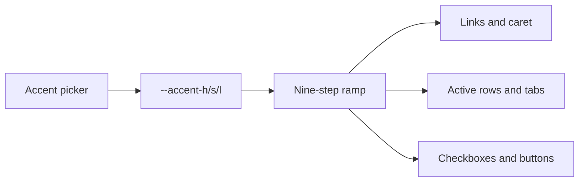

# Kitchen sink

Every element the theme touches, on one page. Open it in Live Preview and in
Reading View and flip between them — the two should not visibly jump.

## Heading two, for sections

### Heading three, for subsections

#### Heading four

##### Heading five

###### Heading six

## Prose and inline

The measure is set to forty-two rem, which lands near sixty-eight characters at
the default size. This paragraph exists to show what a wall of text looks like
before anything decorates it: **bold**, *italic*, ***both***, ~~struck
through~~, ==highlighted==, `inline code`, and a [external link](https://obsidian.md).

An [[internal link]] and an [[unresolved note]] that does not exist yet. A tag:
#reference and another: #theme/nested.

A footnote reference sits here[^1].

[^1]: And the note itself lands at the bottom, in smaller, muted type.

## Lists

- First item
- Second item
  - Nested item
  - Another nested item
    - Third level
- Third item

1. Ordered first
2. Ordered second
   1. Nested ordered
3. Ordered third

- [ ] An open task
- [x] A completed task, dimmed by default
- [ ] A task with a #tag and a [[link]]

## Quote

> The chrome should recede and the writing should not. Tone separates the panes;
> lines are used only where something genuinely needs a boundary.

## Table

| Component | Light | Dark | Notes |
| --- | --- | --- | --- |
| Body text | 17.5:1 | 12.6:1 | Passes AAA |
| Muted text | 5.2:1 | 5.9:1 | Passes AA |
| Links | 4.8:1 | 5.9:1 | Passes AA |
| Faint text | 3.3:1 | 3.5:1 | Non-essential only |

## Code

Inline `const x = 1` and a block:

```js
// Syntax colours are the theme's semantic hues, desaturated to sit inside
// the palette rather than on top of it.
export function ramp({ h, s, l }, steps = 9) {
  return Array.from({ length: steps }, (_, i) => ({
    step: (i + 1) * 100,
    color: `hsl(${h} ${s}% ${l + (4 - i) * 8}%)`,
  }));
}
```

```python
def contrast(fg: str, bg: str) -> float:
    """Relative luminance ratio, WCAG 2.1."""
    l1, l2 = sorted((luminance(fg), luminance(bg)), reverse=True)
    return (l1 + 0.05) / (l2 + 0.05)
```

## Callouts

> [!note] Note
> The default style is a soft fill: no border, a low-alpha wash of the callout's
> own hue, and the title in that hue.

> [!tip] Tip
> Switch to the left-rule variant in Style Settings if you prefer them quieter.

> [!warning] Warning
> Callouts inherit the theme's semantic colours, so they shift with the palette.

> [!danger] Danger
> Including this one.

> [!quote]- A folded callout
> Which opens.

> [!example] Example
> And nests:
> > [!info] Info
> > A callout inside a callout.

## Embeds

![[Kitchen sink#Quote]]

## Math

Inline $e^{i\pi} + 1 = 0$ and a block:

$$
\int_{-\infty}^{\infty} e^{-x^2}\,dx = \sqrt{\pi}
$$

## Diagram



## Rule

---

That is everything.
